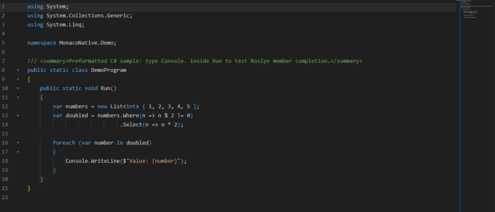
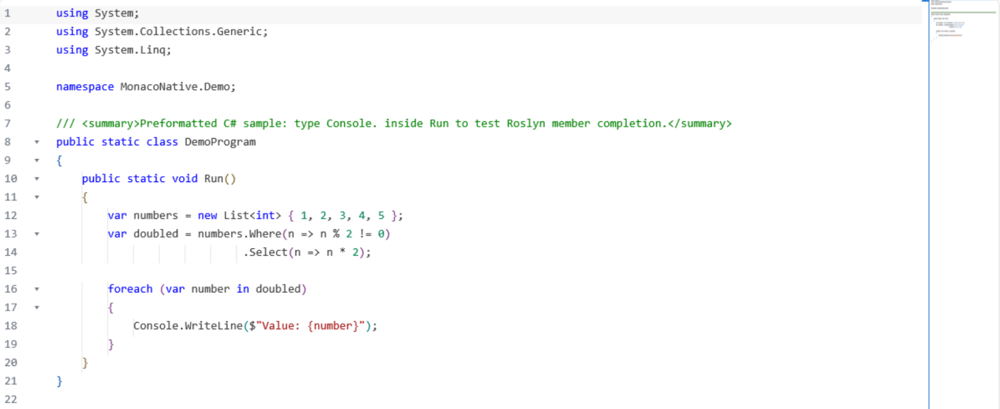
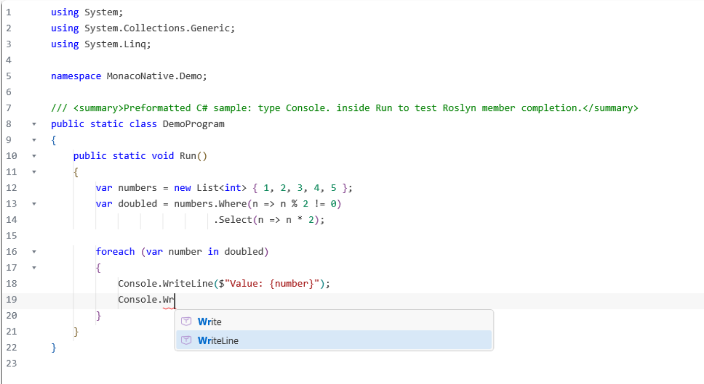
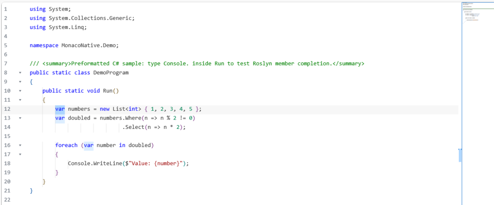

# MonacoNative.WinUI3

A personal hobby project for building a native WinUI 3 code editor without WebView2.

The editor uses a C++20 text core, a WinUI 3 / Win2D renderer, native Windows text input, and in-process language services. Monaco Editor and VS Code are used as behavior and implementation references where it makes sense.

## Features

- Native text model, undo/redo, selections, multi-cursor editing, folding, minimap, find/replace, and diff view
- Syntax highlighting and language-aware indentation
- Completion UI with Codicons, fuzzy ranking, snippet choices, and Visual Studio-style parameter hints
- C# semantic features through in-process Roslyn
- C++ semantic features through in-process libclang
- Native C# / C++ ports for JSON, HTML, CSS, JavaScript, and TypeScript editing features
- VS Code (default) and Visual Studio keybinding profiles with WinUI host overrides
- C++ source formatting through optional LLVM clang-format
- WinUI 3 sample application with C#, C++, JSON, HTML, CSS, JavaScript, and TypeScript samples

Language coverage is listed in [doc/LANGUAGE_SERVICES.md](doc/LANGUAGE_SERVICES.md).

## Screenshots

<table>
  <tr>
    <td width="50%" align="center"><strong>Dark theme</strong>  </td>
    <td width="50%" align="center"><strong>Light theme</strong>  </td>
  </tr>
  <tr>
    <td align="center"><strong>Completion</strong>  </td>
    <td align="center"><strong>Editing</strong>  </td>
  </tr>
</table>

## Build

Requirements:

- Visual Studio 2026 with Desktop development with C++ and .NET desktop development
- Windows SDK 10.0.26100.0
- .NET 10 SDK

Open `MonacoNative.sln`, select `Debug | x64`, restore NuGet packages, and run `MonacoNative.SampleApp`.

C# uses the Roslyn NuGet packages. C++ uses the fixed libclang runtime packages. JSON, HTML, CSS, JavaScript, and TypeScript services run from code in this repository. No Node.js or external language-server process is required for the built-in language packages.

More build details are in [doc/BUILDING.md](doc/BUILDING.md).

For individual Windows test layers use `./scripts/test.ps1 -Layer Build` followed by
`-Layer Core`, `Services`, `WinUI`, and `Integration`. `-Layer All -RunPackages`
runs the complete automated path.

## Documentation

- [Architecture](doc/TECHNICAL_NOTES.md)
- [Language services](doc/LANGUAGE_SERVICES.md)
- [Building](doc/BUILDING.md)
- [Testing](doc/TESTING.md)
- [Keyboard shortcuts](doc/KEYBOARD_SHORTCUTS.md)
- [NuGet deployment and compatibility](doc/PACKAGING.md)
- [Standalone WinUI NuGet consumer](examples/NuGetWinUI3/README.md)
- [Native ABI](doc/NATIVE_ABI.md)
- [Upstream sources and licenses](doc/UPSTREAM.md)

## License

Project code is licensed under the [MIT License](LICENSE). Ported code, dependencies, and icons keep their original licenses and attribution. See [THIRD_PARTY_NOTICES.md](THIRD_PARTY_NOTICES.md) and [doc/UPSTREAM.md](doc/UPSTREAM.md).
